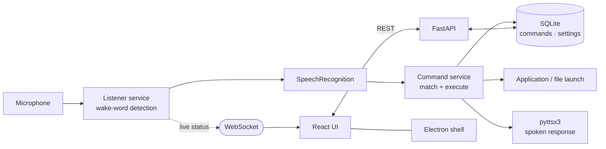

<div align="center">

# ECHO

**Efficient Command Handling Operator — a hands-free desktop assistant
that listens locally and does what you say.**


**v2.0** — rebuilt from a PyQt5 desktop app into a FastAPI + React architecture

</div>

---

## What it does

Say **"Hey Echo"**, then speak a command. ECHO launches applications, opens files and runs
whatever custom commands you have taught it — without touching the keyboard.

Speech recognition and synthesis run **on your machine**. There is no cloud LLM in the
loop, which means no API key, no per-request cost, and no audio leaving the device.

## Architecture



The backend splits into three services — `listener` (wake word and audio capture),
`speech` (recognition and synthesis) and `commands` (matching and execution) — each
behind its own API module. The frontend never talks to hardware; it drives the backend
over REST and receives live state over a WebSocket.

## Features

| | |
|:--|:--|
| **Wake word** | "Hey Echo" activation, always-on listening |
| **Command execution** | Launch applications, open files, run custom commands |
| **Custom commands** | Add, edit and delete through the UI; persisted in SQLite |
| **Live status** | WebSocket pushes listening state to the interface instantly |
| **Voice options** | Male or female text-to-speech voice |
| **Desktop app** | Packaged with Electron and electron-builder |

## Stack

| Layer | Choice |
|:--|:--|
| API | FastAPI with WebSocket support |
| Speech-to-text | `SpeechRecognition` + `PyAudio` |
| Text-to-speech | `pyttsx3` |
| Persistence | SQLite |
| Validation | Pydantic |
| UI | React 18 + Vite |
| Desktop shell | Electron 33 |

## Quick start

**Prerequisites:** Python 3.12+, Node.js 18+, a working microphone.

```bash
git clone https://github.com/Asik-Ifthaker-Hamim/ECHO.git
cd ECHO

pip install -r backend/requirements.txt
npm install

npm run dev          # backend on :8000 and Vite UI together
```

Or use the bundled launchers — `start.bat` on Windows, `start.sh` elsewhere.

Run the desktop shell instead of the browser:

```bash
npm run dev:electron
```

Build a distributable:

```bash
npm run build
```

> On Linux, `pyaudio` needs `portaudio19-dev` installed first. On macOS,
> grant microphone permission to the terminal or the packaged app.

## Repository layout

```
backend/app/
  api/         commands · listener · settings routes
  services/    speech · listener · commands
  models/      database, repository, schemas
  main.py
frontend/src/
  components/  CommandForm · CommandList · SettingsPanel · StatusDisplay
  services/    api client
  App.jsx
main.py, design.py   Legacy v1 PyQt5 entry points
```

`MIGRATION.md` and `UPGRADE_SUMMARY.md` document the move from v1 to v2;
`QUICKSTART.md` and `DEVELOPMENT.md` cover setup and contribution in more depth.

## Author

**A.M. Asik Ifthaker Hamim** — Associate AI Engineer, Liberate Labs
[Portfolio](https://asik-ifthaker-hamim.netlify.app/) ·
[Google Scholar](https://scholar.google.com/citations?hl=en&user=0VYBJUsAAAAJ) ·
[ORCiD](https://orcid.org/0009-0006-6361-6277)
